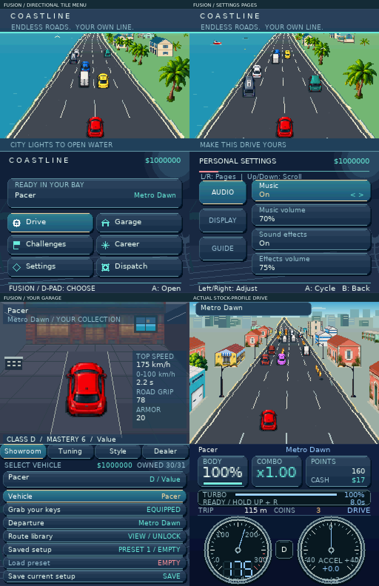
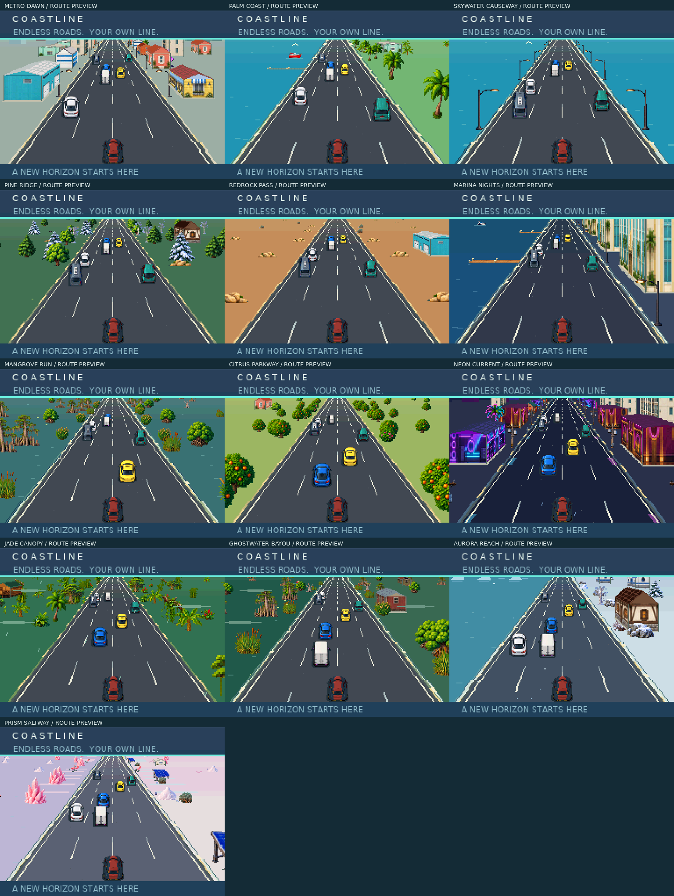

# Coastline: Endless Drive

An original **Nintendo DS** procedural highway driving game for Delta.
Drive from the city to tropical coastlines, an ocean causeway, pine forests,
red-rock canyons, a neon marina, mangrove wetlands and citrus groves, then
into a neon metropolis, jungle, ghostly bayou, aurora coast and luminous saltway.
Earn points and cash, collect an itemized traffic ticket, and return
to the garage to buy, tune and customize your vehicles. Optional dispatch
contracts give each run a specific driving goal.

- [Watch the dual-screen opening](drive/dist/Opening.gif)
- [See the opening and save slots](drive/dist/Opening.png)
- [Download the DS cartridge](drive/dist/Coastline.nds)
- [Download the complete ZIP](drive/dist/Coastline-DS.zip)
- [Compare Midnight, Apex, Signal and Fusion interfaces](drive/dist/Interface.png)
- [See the Fusion interface](drive/dist/Fusion.png)
- [See all four garage tabs](drive/dist/Garage.png)
- [See departure-themed garage interiors](drive/dist/Garage-Interiors.png)
- [See customization and saved setups](drive/dist/Progression.png)
- [Controls, progression and build instructions](drive/README.md)



The game opens with a continuous drive across both screens, a wide sky,
clouds and animated birds. Press any button, choose one of three independent
save slots with Up/Down and A, and the driving view slides up to reveal the
main menu below. B from the main menu returns to the save selector.

R accelerates, L brakes/reverses, Left/Right steer, Up adds Turbo, Down adds
Slow, B is a controlled drift, and A is the horn or motorcycle wheelie. All driving
modifiers are held. Start pauses. All menus use buttons on the lower screen;
while driving, that screen becomes a noninteractive instrument dashboard.
Touch input is ignored throughout.

The driving dashboard puts health, combo, points, cash and the new turbo reserve
above the gauges. Turbo lasts eight seconds from full and refills through near
misses, controlled drifts, motorcycle wheelies and Slow recovery. A 5x score
combo gives 2x skill recharge. The Turbo Guide explains the rates in game.

Combos grow in exact quarter-steps. Full-speed streaks take 48 seconds to reach
5x before perks; drifting and wheelies take 24 seconds. Stopping lets the
chasing police close in and end the run. The ticket lists your bonuses and
awards the earned cash to your wallet.

Roadside buildings use projected walls and roofs that share the road's
vanishing point. Houses, tree clusters and large waterfront props have their
own placement rules across frontage, middle-distance and distant layers.
Distinct local architecture, vegetation and atmospheric effects give each region
a theme. Boats use upright profiles, and short connected docks
reach the water from the shoreline. Overhead signs remain removed.

This version contains 31 vehicles, thirteen regions, seeded traffic and road
coins, close-overtake bonuses, capped speed/drift/wheelie streaks, four tracks of
six-stage parts, vehicle mastery, handling setups and shared career perks.
Classes D/C/B/A/S require 0/2/5/8/10 owned vehicles to purchase from. Each class
includes five core roles; six extra novelty rides include skates, a bicycle,
a moped, a Segway, a skateboard and a horse. The garage separates owned-car
Showroom, Tuning, Style and class-based Dealer tabs. Three presets save a car,
installed build, finish and departure. Paint, liveries, wheel finishes and smoke
colors are paid installations; returning to a previous finish costs half price.
Midnight retains the glass interface, Apex adds a bright tile workspace and
Signal adds a driver terminal. The fourth interface, **Fusion**, combines Midnight
styling, a four-direction tile menu and settings pages switched with L/R.
Vehicle-specific dashboards accompany
independent music/SFX settings. Purchases and progression persist in cartridge
battery saves, including migration from the first draft. The standard motorcycle
is a cash purchase without a challenge requirement. Special gear, paint and
locations use challenge rewards.



Scenery captures use a documented pre-unlocked battery-save fixture for visual
review. The main validation plays a fresh profile and checks normal earnings,
purchases and save reloads. No emulator RAM writes or save-state restores are used.

## Build and validate

```sh
bash drive/tools/setup_nds.sh
make -C drive -j2
bash drive/tests/setup_emulator.sh
python3 drive/tests/playthrough.py --output drive/build/studio-validation
python3 drive/tests/studio.py
python3 drive/tests/opening.py
python3 drive/tests/migration.py --output drive/build/studio-validation
python3 drive/tests/studio_migration.py
python3 drive/tools/package.py
```

The game, original artwork, procedural generator and test harness live in
`drive/`. No web server is needed. The build creates `drive/build/Coastline.nds`;
generated assets and emulator artifacts stay in ignored `drive/build/`.
Tests execute native rules with sanitizers and the real ARM9/ARM7 cartridge in
DeSmuME. Phone/Delta and physical hardware testing are separate.

The earlier Asterwild DS game remains in [nds/](nds/README.md), and the original
Bramblebound GBA experiments remain in `src/`, `tools/` and `dist/` and their
release branches. Coastline has its own gameplay and save format.
