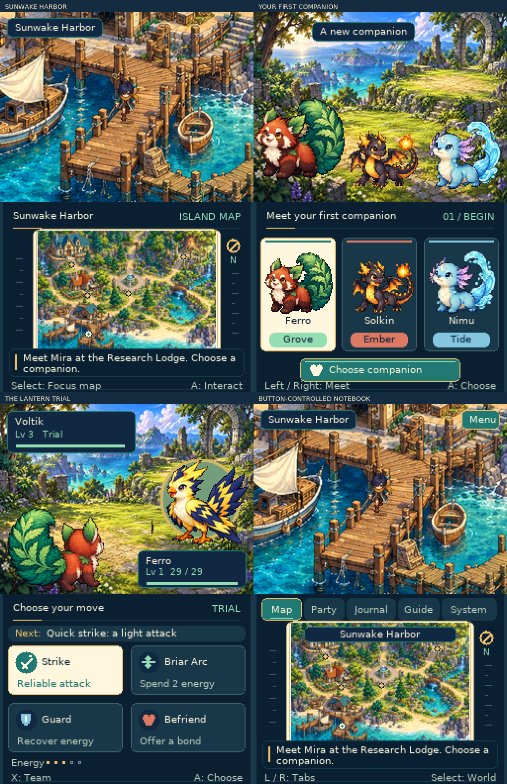

# Asterwild: Lantern Isles

A new, original **Nintendo DS** creature-catching RPG opening. Explore an
illustrated coastal island, choose a companion, meet wild creatures, help the
gardens, and challenge the first lantern trial.

- [Download the DS ROM](nds/dist/Asterwild.nds)
- [Download the complete ZIP](nds/dist/Asterwild-DS.zip)
- [Controls, gameplay and build instructions](nds/README.md)



The lower screen displays the island map during exploration. **Select** switches
focus to its notebook; **L/R** change tabs, and the **D-pad and A/B** navigate.
Select returns focus to exploration. The game uses buttons throughout; there
are no touch controls.

The opening includes three starter choices, six original creature designs,
visible encounters, guaranteed trust-based recruitment, tactical battles,
shared experience, two growth paths, a side quest, a party, a field guide,
a journal, music, cartridge saves and a first-trial ending.

## Build

```sh
bash nds/tools/setup_nds.sh
make -C nds -j2
```

The native ARM9/ARM7 game, original artwork and asset pipeline are in `nds/`.
The build produces `nds/build/Asterwild.nds`. See the [DS README](nds/README.md)
for dependencies, controls and scope.

## Validation

```sh
bash nds/tests/setup_emulator.sh
make -C nds test
```

Tests exercise the rules with sanitizers, check the actual painted-world routes,
and play the native DS ROM using buttons in DeSmuME. They cover the opening,
notebook focus and tabs, recruitment, the blossom quest, battle switching,
growth, the trial, audio and a battery-save reload in a separate process. Pixel
checks verify the player can pass behind tree canopies. Generated screenshots,
test saves and reports stay under ignored `nds/build/`.

The earlier Bramblebound GBA experiment remains in the repository's original
`src/`, `tools/` and `dist/` folders and its release branches. Asterwild has new
artwork, world geometry, characters, rules, rendering and a separate save format.
